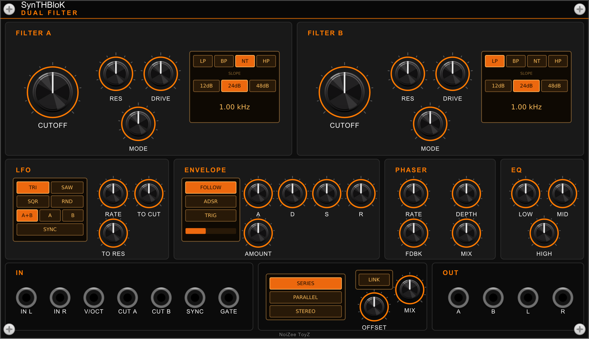

# SynTHBloK Dual Filter

A free VCV Rack 2 plugin by **NoiZee ToyZ** (part of the SynTHBloK series).



| Module | What it does |
|---|---|
| **Dual Filter** | Two stereo multimode filters (LP / BP / notch / HP sweep, 12 / 24 / 48 dB) with drive, run in series, parallel or stereo, linked cutoffs, a four-shape LFO, an ADSR or envelope follower, a stereo phaser and a three-band EQ |

## Install

In VCV Rack 2: **Library**, search **SynTHBloK Dual Filter**, **Add**.

## Build

```
make RACK_DIR=/path/to/Rack-SDK   # or: make dist / make install
```

## Licence

GPL-3.0-or-later (see `LICENSE.txt`). The SynTHBloK and NoiZee ToyZ names and logos are not covered by the licence.
